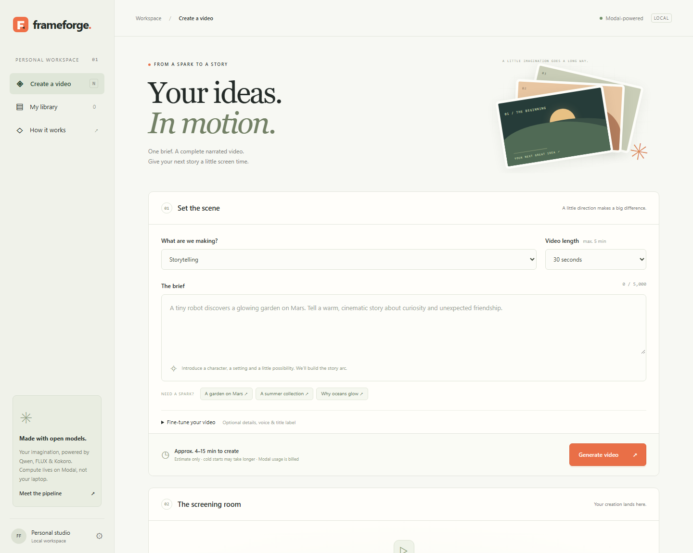
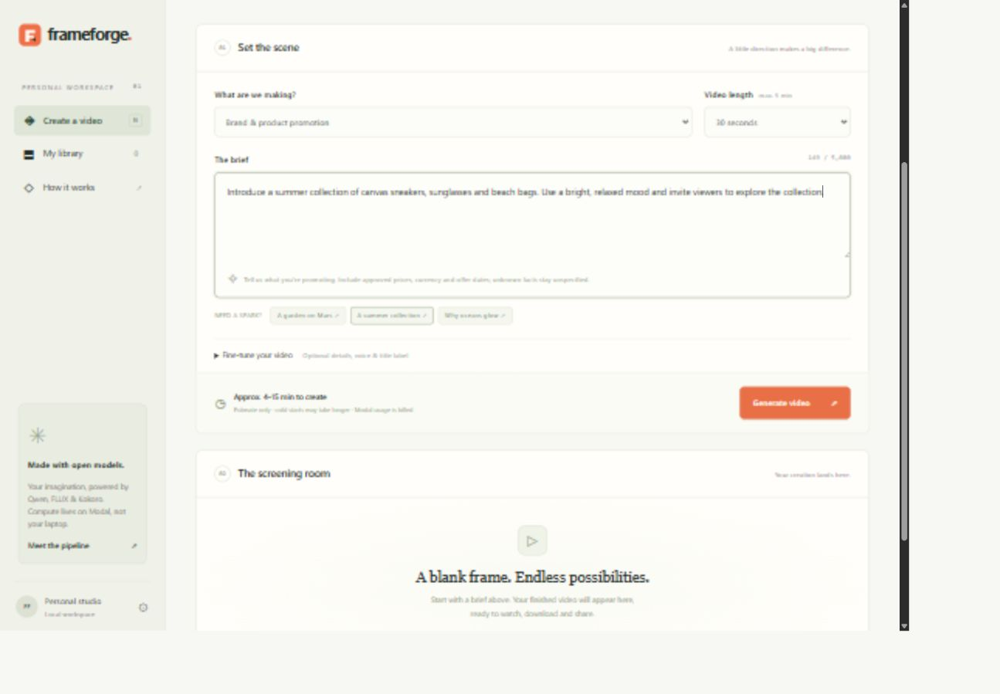
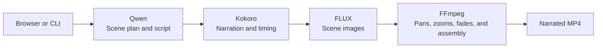

# Frameforge Studio

Turn a written brief into a narrated 720p video. Frameforge Studio pairs a local browser workspace with a Modal pipeline that writes scripts, synthesizes speech, generates scene images, and animates those stills into an MP4.



<details>
<summary>See the product promotion workspace</summary>



</details>

## What you can do

- **Start with a brief.** Choose storytelling, product promotion, or an educational explainer. Set the duration from 1 to 300 seconds and choose an English narration voice.
- **Supply approved facts.** Add details such as product features, prices, and deadlines. The script pipeline checks promotional claims against the supplied brief.
- **Follow and resume jobs.** Track generation stages in the browser, revisit past jobs in the SQLite-backed library, and resume a failed or interrupted job from available checkpoints.
- **Review and export.** Play the result in the studio and download the H.264/AAC MP4 or inspect the generation report.

## Run locally

Use Python 3.11 or 3.12. The studio runs on FastAPI and serves static HTML, CSS, and JavaScript directly. Modal handles inference and FFmpeg rendering.

**Windows PowerShell**

```powershell
python -m venv .venv
.\.venv\Scripts\python.exe -m pip install -r requirements.txt
.\.venv\Scripts\python.exe run.py
```

**macOS or Linux**

```bash
python3 -m venv .venv
.venv/bin/python -m pip install -r requirements.txt
.venv/bin/python run.py
```

Open [http://127.0.0.1:8000](http://127.0.0.1:8000) to explore the interface without cloud credentials. Configure Modal before selecting **Generate video**. Generation uses your Modal account and can incur charges.

## Enable video generation

Run these commands from the project root using the virtual environment’s Python. If your environment is inactive, use the executable path from the previous section in place of `python`.

1. Authenticate to your Modal workspace with `python -m modal setup`. Verify the active workspace with `python -m modal profile current`.
2. In the Modal dashboard, create a secret named `frameforge-huggingface` with the key `HF_TOKEN`. Use a Hugging Face token with the access needed by the selected models.
3. Deploy the inference workers.

   ```bash
   python -m modal deploy modal_workers.llm
   python -m modal deploy modal_workers.image
   python -m modal deploy modal_workers.kokoro_tts
   ```

4. Start the studio with `python run.py` and submit a short test brief. The CLI starts the video orchestrator for each job.

For optional settings, copy [`.env.example`](.env.example) to `.env` at the project root. If you change `FRAMEFORGE_NAMESPACE`, create the matching `<namespace>-huggingface` secret and redeploy the workers under the same prefix.

### CLI

The CLI accepts briefs directly. Use `--script-only` to produce reviewed script artifacts without generating media.

```bash
python main.py "A robot finds a garden on Mars" --duration 30
python main.py "Explain the water cycle" --duration 60 --script-only
```

## How it works



| Location | Responsibility |
| --- | --- |
| [`web/`](web/) | FastAPI routes, browser UI, and a persistent local queue that runs one generation job at a time |
| [`modal_workers/`](modal_workers/) | Qwen2.5-7B scripting, Kokoro-82M speech, FLUX.1-schnell imagery, FFmpeg rendering, and checkpoint storage |
| [`video_plan.py`](video_plan.py) and [`video_quality.py`](video_quality.py) | Brief validation, scene timing, source-bound offer checks, and script review |
| [`render/`](render/) | Motion expressions for pans and zooms |

Web jobs and their assets live in `data/`. CLI jobs default to `workspace/videos/`. Remote checkpoints live in the Modal volume named `<namespace>-jobs`.

## Credentials and local data

- Keep Modal credentials in your local Modal profile or the ignored server-side `.env`, and store `HF_TOKEN` in the Modal dashboard. The example env file contains configuration defaults and blank credential fields.
- The Settings dialog accepts only the optional `STUDIO_API_TOKEN`, which the browser stores in the current tab’s session storage. Keep the single-owner studio on loopback with `python run.py`.
- Keep job databases, prompts, worker logs, and generated media private. The default runtime directories are ignored by Git.

## Tests

```bash
python -m unittest discover -v
```

The local suite covers planning, rendering math, queue recovery, request validation, and access controls. It uses mocked cloud calls.

Scene images are generated independently, so people, products, and logos can vary between shots. The pipeline builds motion from stills, and its script review uses the provided brief. Verify factual claims and check visual consistency before publishing a video.
